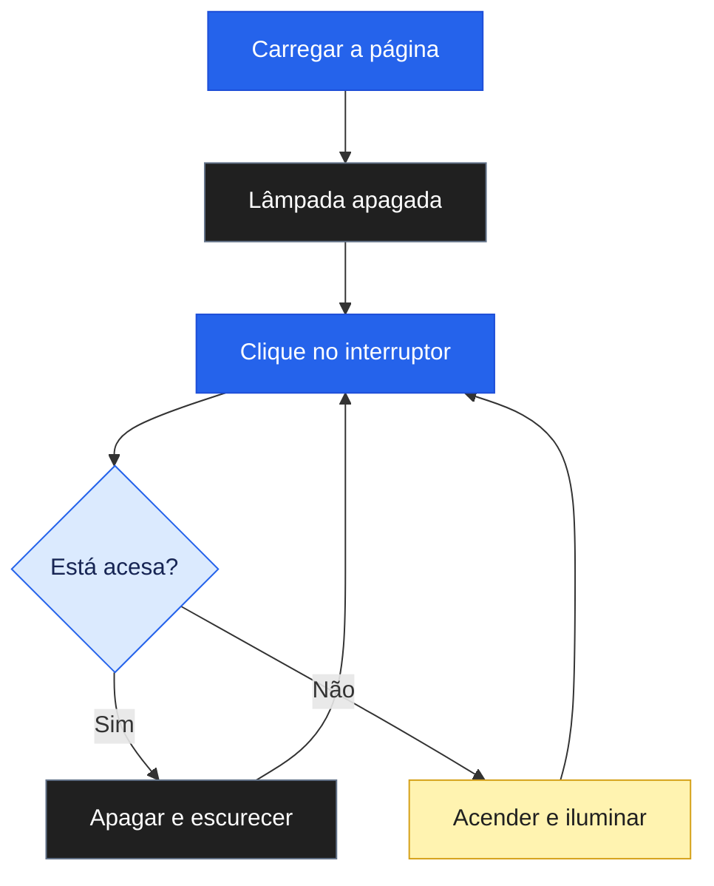

<div align="center">

# 💡 Lâmpada Funcional

**Da lógica de programação à luz.**


<a href="https://hildebertosampaiojr-bot.github.io/Lampada-Funcional/"></a>
<a href="#-como-executar-localmente"></a>

</div>

---

Simulador de um interruptor de luz desenvolvido como trabalho acadêmico de JavaScript. O projeto demonstra como a lógica de programação pode controlar o comportamento e a aparência de uma interface web em tempo real.

## 🎯 Objetivo

Praticar estruturas condicionais, variáveis booleanas, eventos e manipulação do DOM, integrando HTML, CSS e JavaScript em uma aplicação simples e interativa.

## 🛠️ Tecnologias utilizadas

<div align="center">


</div>

| Tecnologia | Aplicação no projeto |
| --- | --- |
| **HTML5** | Estrutura da página, painel, interruptor e indicador de estado. |
| **CSS3** | CSS Grid, centralização, cores, filtros visuais, transformações e transições suaves. |
| **JavaScript (Vanilla JS)** | Controle do estado da lâmpada, eventos de clique e atualização dinâmica da interface. |
| **DOM API** | Seleção de elementos, alteração de classes, textos e atributos de acessibilidade. |
| **Git** | Controle de versões do código-fonte. |
| **GitHub** | Hospedagem e gerenciamento do repositório. |
| **GitHub Pages** | Publicação da aplicação na web. |

O projeto não depende de frameworks, bibliotecas externas, banco de dados ou servidor de aplicação.

## ⚙️ Funcionalidades

- Acender e apagar a lâmpada pelo interruptor.
- Alterar as cores de fundo e do texto conforme o estado da iluminação.
- Simular a iluminação por filtros e transformações CSS.
- Atualizar o texto do botão e a mensagem de estado.
- Atualizar o atributo `aria-label` para indicar se a lâmpada está acesa ou apagada.

## 🧠 Como funciona

<div align="center">


&nbsp; ⇄ &nbsp;


</div>

A variável booleana `acesa` começa com o valor `false`. Um evento de clique no botão dispara uma estrutura condicional `if/else`, que alterna o estado da lâmpada.

| Estado | Interface | Ação disponível |
| --- | --- | --- |
| Apagada | Fundo escuro e lâmpada escurecida | Acender |
| Acesa | Fundo claro e lâmpada iluminada | Apagar |

O JavaScript modifica as classes CSS e o conteúdo dos elementos selecionados pelo DOM. O CSS realiza a mudança visual com transições de 0,3 segundo.

## 🔄 Fluxo do interruptor



## 📁 Estrutura do projeto

```text
Lampada-Funcional/
├── index.html   # Estrutura da interface
├── estilo.css   # Identidade visual e transições
├── script.js    # Lógica do interruptor
└── README.md    # Documentação
```

## 🚀 Como executar localmente

```bash
git clone https://github.com/hildebertosampaiojr-bot/Lampada-Funcional.git
cd Lampada-Funcional
```

Abra o arquivo `index.html` em um navegador atualizado. Se preferir, utilize a extensão Live Server no Visual Studio Code.

## 📚 Conceitos praticados

- Declaração de constantes e variáveis com `const` e `let`.
- Tipos booleanos e estruturas condicionais.
- Eventos com `addEventListener`.
- Seleção de elementos com `getElementById`.
- Manipulação de `className`, `classList`, `textContent` e `setAttribute`.
- Separação entre estrutura, apresentação e comportamento.

## 🔗 Outro trabalho acadêmico

Conheça também o **[Oro Café](https://github.com/hildebertosampaiojr-bot/Cafeteria---Trabalho-javascript)**, uma aplicação de cafeteria com cardápio, carrinho, acompanhamento de pedidos e jogos interativos.

[Abrir Oro Café](https://hildebertosampaiojr-bot.github.io/Cafeteria---Trabalho-javascript/)

---

<div align="center">

 

**Desenvolvimento web front-end · Trabalho acadêmico**

[Voltar ao topo](#-lâmpada-funcional)

</div>
